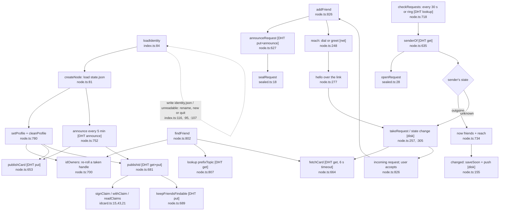

# 1. Identity, friends and discovery

Happy path: identity load → profile → published card and ID card → friend request (direct link or sealed DHT announcement) → accepted → linked.

**Depends on:** transport (`net.dial`, `lookup`, `announce`, `putShared`; network.ts:218-240), `thumbnail` (index.ts:446), messaging (`hi`/`greet` send the DM's `have`).

**Gaps:** network.ts internals were only grepped.
