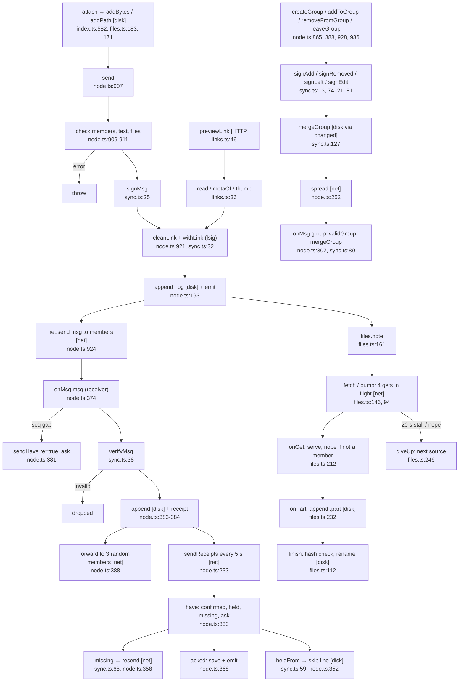

# 2. Messaging, groups and files

Happy path: send → sign → log → send to members → receiver verifies, appends, forwards (groups) → receipts → missing-message sync.

**Depends on:** friends (`members()` needs `friend` state), transport (`net.send`, `backlog`, `relayed` for files), the IPC bridge (index.ts:513).

**Gaps:** the renderer side (`useLinkDraft`, `Chat.tsx`) was not traced.
