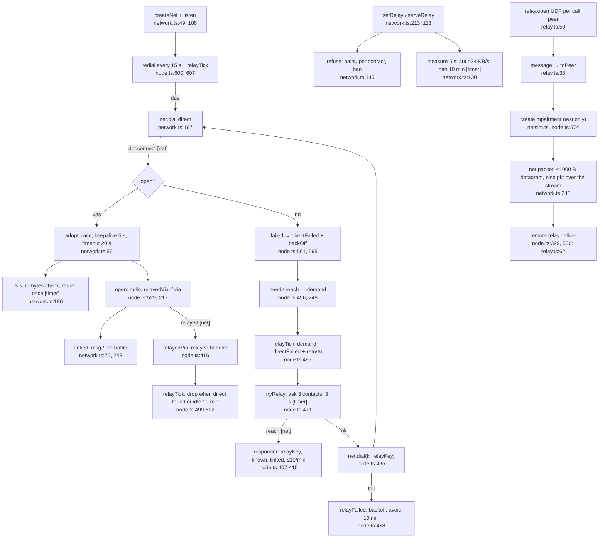

# 3. Transport and relay

Happy path: a direct dial succeeds and is adopted. When it fails, the peer is reached through a relaying friend. Call packets are ferried over the link when WebRTC can't connect directly.

**Depends on:** friends (`admit` = `known` or `outgoing`, node.ts:522), calls (`relayOpen`/`relayClose` over IPC, node.ts:960-961).

**Checked:** `createNet(keyPair, handlers, dht, links, strict)` (node.ts:514-571) matches the signature `(keyPair, on, dhtOpts, allow, strict)` (network.ts:49). The tracer's suspicion that the arguments were off by one was wrong.
