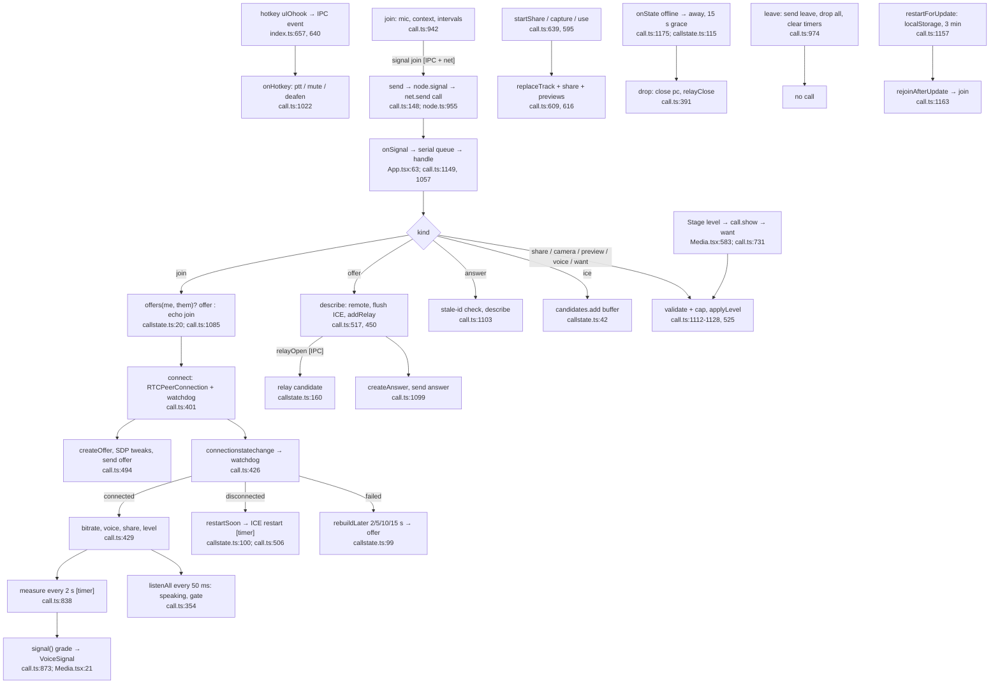

# 4. Calls and media

Happy path: join → signals queued in order → the smaller key offers → answer → ICE → connected → sampling. The watchdog restarts or rebuilds; leaving drops everything.

**Depends on:** transport (signals over `net.send`, the UDP relay), friends (`members` check in `node.signal`, node.ts:955).

**Checked:** `drop` (call.ts:391) adds the call-level cleanup on top of `close` (call.ts:379), and `leave` (call.ts:974) calls `drop` per peer, then clears the call-wide state. That's layering, not duplicated cleanup.
