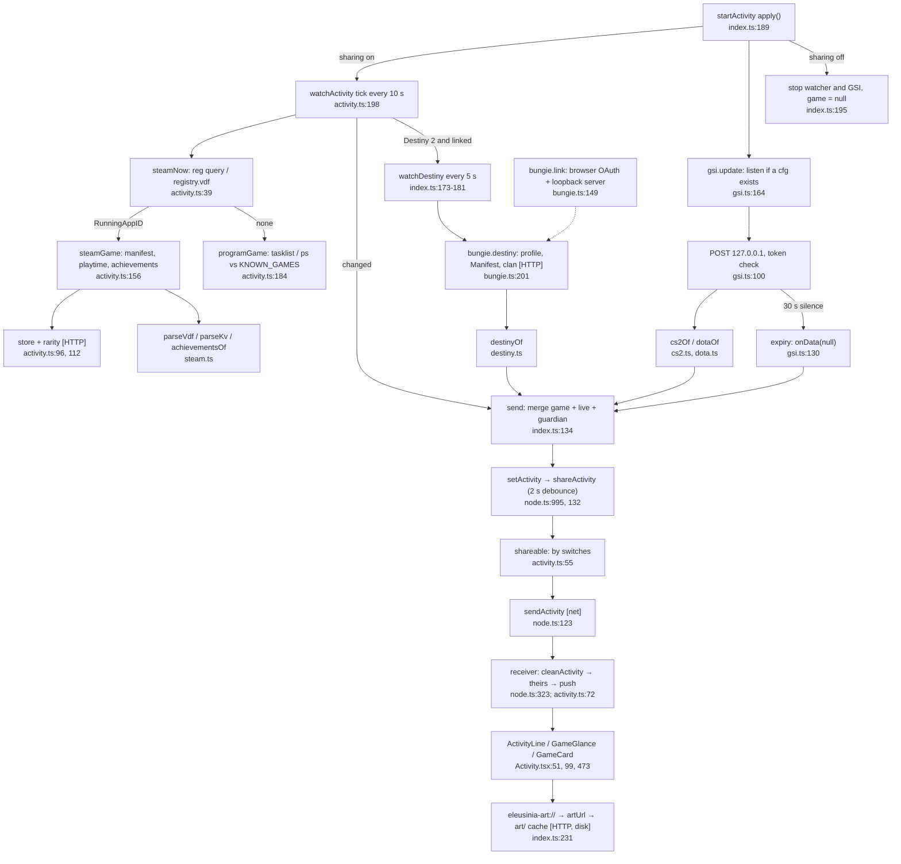

# 5. Activity

Happy path: the watcher finds the game every 10 s, GSI or Bungie adds live details, the parts are merged, filtered by the sharing switches and sent to linked friends. The receiver cleans what arrives and shows it.

**Depends on:** messaging/transport (`net.send`, `known`), the UI (Settings → Activity, `Connections`).

**Doc drift:** CLAUDE.md says Destiny's `GetProfile` runs every 30 s, but `setInterval(tick, 5000)` is at index.ts:181.
