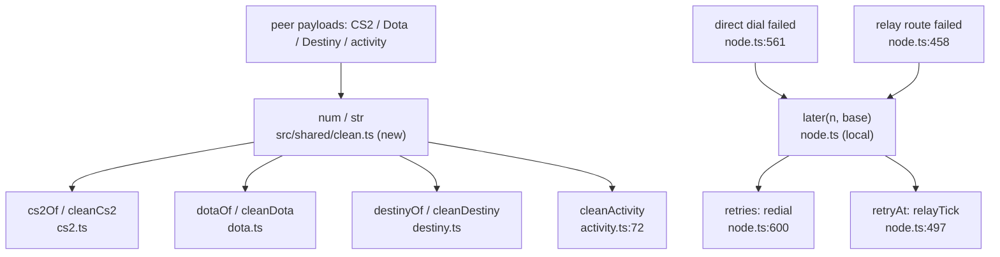

# Unified proposal

Only D1 and D2 are accidental. Both fixes delete code; neither adds a layer.

## U1. `src/shared/clean.ts`: one set of value clamps
- **Component:** `src/shared/clean.ts` exports `num(v, max = 1e6)` and `str(v, max)` (trimmed, `undefined` when empty).
- **Call sites:**
  - `cs2.ts:39`, `dota.ts:50`, `destiny.ts:44`: delete the local `num` and import it.
  - `destiny.ts:43` `text`: delete it and import `str` (rename the uses).
  - `activity.ts:67` `str`: delete it and import.
  - `links.ts:41` (collapses whitespace), `reports.ts:53` (returns an empty string) and `activity.ts:68` `int` stay as they are, because they behave differently.
- **Capability lost:** none. The behaviour is identical, and the existing tests (`gsi`, `dota`, `destiny`, `activity`) prove it.

## U2. One backoff in `node.ts`
- **Component:** a local `later(n, base) = Date.now() + base * Math.min(2 ** (n - 1), 20)` in `node.ts`. It's used by both functions, and the maps stay as they are.
- **Call sites:** `backOff` (`node.ts:597`) and `relayFailed` (`node.ts:463`).
- **Capability lost:** none. Merging the maps as well (`retries` against `fails` + `retryAt`) was considered and rejected: they track different things (direct dial against relay route) and get reset at different times.

## Combined view

Rejected on purpose: a shared polling scheduler, a generic local HTTP server helper, a shared safeStorage format, a hex-regex library. Each would add a layer over code that is legitimately different.
